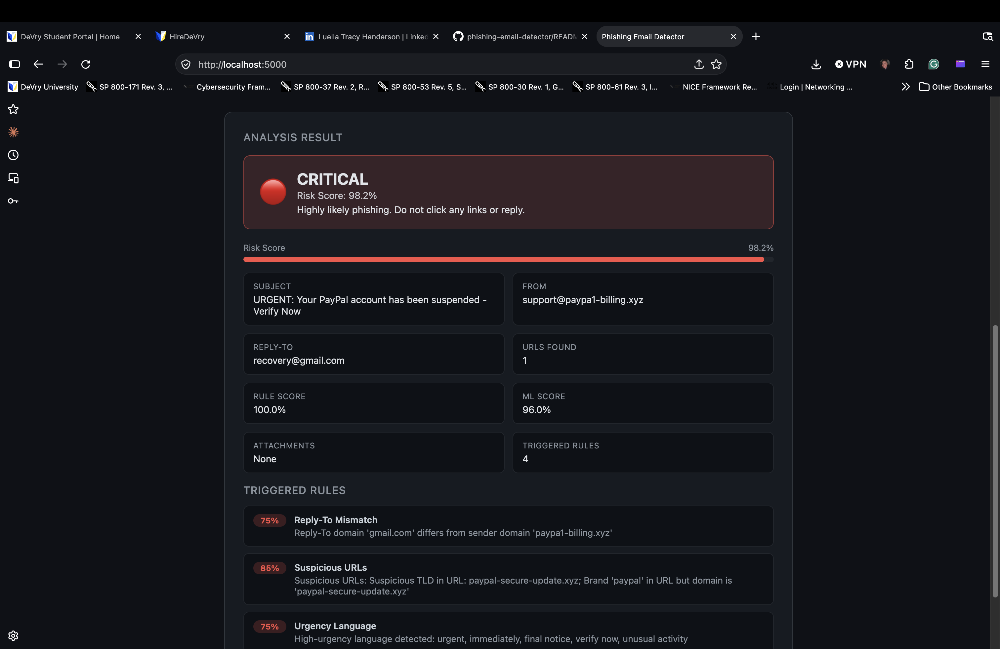

# Phishing Email Detector

A three-layer phishing email detector that combines a rule-based engine, a machine learning classifier, and a hybrid scorer. It reports a risk score from 0 to 100% with a verdict from SAFE to CRITICAL and lists the specific reasons behind it.

This is a portfolio project. The classifier is trained on a small sample dataset, so treat it as a proof of concept and not a production filter.

## How it works

1. **Rule-based engine** (`detector/rule_engine.py`): checks sender display name spoofing, Reply-To mismatches, suspicious URLs (IP addresses, odd top-level domains, URL shorteners, brand impersonation), urgency and threat language, credential harvesting phrases, financial scam language, dangerous attachment extensions, and subject line anomalies.
2. **ML classifier** (`detector/ml_classifier.py`): TF-IDF features with bigrams on the subject and body, plus engineered features such as URL count and urgency word count, fed to a voting ensemble of Logistic Regression and Random Forest.
3. **Hybrid scorer** (`detector/hybrid_analyzer.py`): combines the rule score and the ML probability into one risk score and a verdict: SAFE, LOW, MEDIUM, HIGH, or CRITICAL.

## Setup

Requires Python 3.9 or newer.

    git clone https://github.com/Luella-Cyber/phishing-email-detector.git
    cd phishing-email-detector
    python3 -m venv venv
    source venv/bin/activate
    pip install -r requirements.txt
    python3 cli.py --train

The trained model is not stored in the repository, so run the `--train` step once after cloning.

## Usage

Run the built-in demo emails:

    python3 cli.py --demo

Analyze a saved email file:

    python3 cli.py --file email.eml

Analyze an email by its parts:

    python3 cli.py --subject "Verify your account" --sender "PayPal <billing@paypa1-support.com>" --body "Click here now"

Output as JSON:

    python3 cli.py --demo --json

Start the web interface:

    python3 app.py

Then open the address printed in the terminal.

## Demo results

| Sample email | Verdict | Rule score | ML score | Final score |
|---|---|---|---|---|
| Phishing (shortened link, spoofed sender) | CRITICAL | 100.0% | 96.0% | 98.2% |
| Legitimate Amazon shipment notice | SAFE | 0.0% | 40.4% | 18.2% |

The legitimate email shows why the layers are combined. The ML model alone is unsure (40.4%), and the rule layer, which found no violations, brings the final score down to a safe level.

## Project structure

    app.py                    Flask web interface
    cli.py                    Command-line interface
    requirements.txt          Python dependencies
    data/training_data.csv    Labeled sample emails for training
    detector/
        email_parser.py       Parses .eml files and raw text
        rule_engine.py        Rule-based checks
        ml_classifier.py      Trains and runs the classifier
        hybrid_analyzer.py    Combines both scores

## Limitations

- The training set is small (about 40 sample emails), so the ML layer is not reliable on its own. The rule layer carries most of the detection.
- Results from the two demo emails are not an accuracy measurement. A proper evaluation would need a larger labeled dataset and a held-out test set.
- The detector reads email content only. It does not check live URLs, sender reputation, or SPF, DKIM, or DMARC results.

## Next steps

- Train on a larger public phishing dataset and report precision and recall on a held-out set
- Add unit tests for each rule
- Add SPF, DKIM, and DMARC header checks

## Author

Luella Tracy Henderson | [LinkedIn](https://www.linkedin.com/in/luellatracyhenderson) | [GitHub](https://github.com/Luella-Cyber)
